# Demo Screenshot Gallery

Every demo, rendered in a real browser at 1280 x 720. See [DEMOS.md](DEMOS.md) for how to run and rebuild them, or open the [visual gallery](SCREENSHOTS.html) locally.

- Captured demos: 23
- Format: JPEG

## 3d/fluids (4)

### blender-screen-water

Build and render a top-fed Blender FLIP water sheet for tall displays, with clear-water optics, dark depth, feathered reflections and clustered 3D bubbles. Use for cold or hot screen-water effects, native rerenders, partial-loop encoding and drain-and-fade playback. Product geometry and camera choreography are separate.

[Open the live demo](https://loouis.github.io/skills/blender-screen-water/demo/) · [Skill](skills/3d/fluids/blender-screen-water) · [Prompt](skills/3d/fluids/blender-screen-water/demo/PROMPT.md)

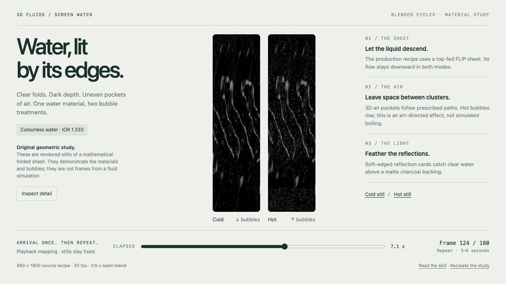

### water-optics-clear-studio

Reproduce and refine clear studio water in Blender with droplet, immersed air-cavity, folded-surface and curved product-contact recipes. Use for transparent contours, reflected lettering, calm pools and local ripples; evaluate motion and fluid dynamics separately.

[Open the live demo](https://loouis.github.io/skills/water-optics-clear-studio/demo/) · [Skill](skills/3d/fluids/water-optics-clear-studio) · [Prompt](skills/3d/fluids/water-optics-clear-studio/demo/PROMPT.md)

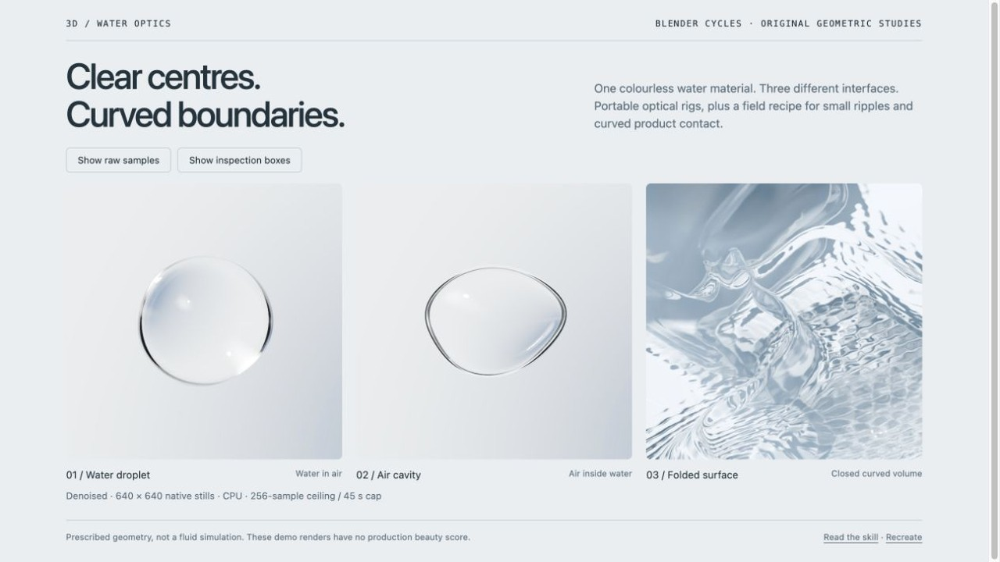

### water-pool-sunlight

Make sunlit swimming-pool water in Blender Cycles with the net of sunlight on the pool floor (caustics) and the sun rays coming down through the water, both read from one ray-density map so every shaft stands on a bright patch of floor. Use for any underwater or pool scene that needs floor caustics, light shafts, god rays or dappled water light, as a still or a seamless loop, and whenever a caustic texture reads as a tiled pattern, cracks, marble or wire; evaluate the water surface seen from below and fluid simulation separately.

[Open the live demo](https://loouis.github.io/skills/water-pool-sunlight/demo/) · [Skill](skills/3d/fluids/water-pool-sunlight) · [Prompt](skills/3d/fluids/water-pool-sunlight/demo/PROMPT.md)

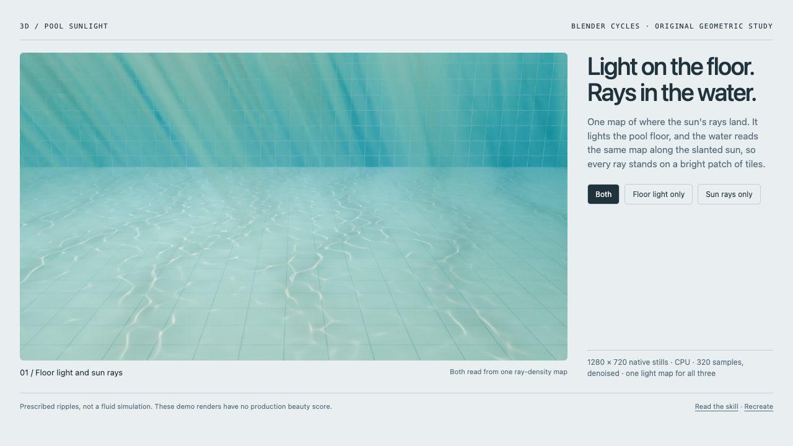

### water-product-splash

Reconstruct and refine suspended product-water splashes in Blender, including folded sheets, torn rims, jets, ligaments, droplets and optical distortion. Use for water wrapping around or breaking away from a product, reference-led splash studies, and adapting a reviewed splash to another product. Still reconstruction is tested; validate new collisions and motion separately.

[Open the live demo](https://loouis.github.io/skills/water-product-splash/demo/) · [Skill](skills/3d/fluids/water-product-splash) · [Prompt](skills/3d/fluids/water-product-splash/demo/PROMPT.md)

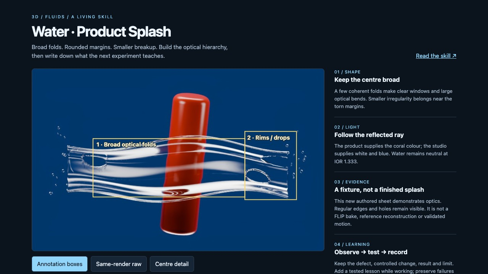

## 3d/interiors (1)

### coastal-interior-render

Build and refine editable Blender/Cycles coastal apartment interiors with warm timber, restrained stone, natural daylight and tactile furniture. Use for premium beachfront kitchen/living scenes, Burly- or MIRA-inspired art direction, practical layout, kitchen construction, upholstery, throws/fringe, glazing, balconies, reference comparison and annotated realism reviews. Includes detailed modelling, material, lighting and failure-recovery methods. Do not use as a promise of an automatic quality score, a construction specification or a substitute for a requested direct 3D render.

[Open the live demo](https://loouis.github.io/skills/coastal-interior-render/demo/) · [Skill](skills/3d/interiors/coastal-interior-render) · [Prompt](skills/3d/interiors/coastal-interior-render/demo/PROMPT.md)

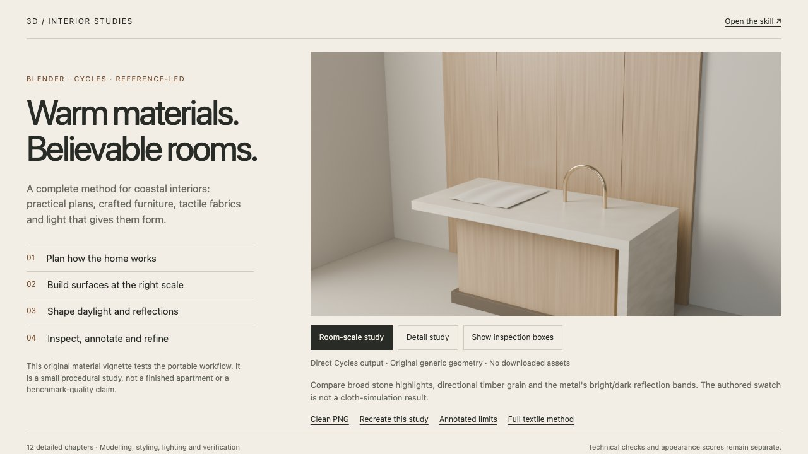

## 3d/materials (1)

### blender-polished-chrome

Create realistic chrome and mirror-polished metal renders in Blender Cycles. Use for polished stainless steel, chrome plating, satin-looking metal, harsh reflection bands, and studio material or lighting refinement while preserving product geometry.

[Open the live demo](https://loouis.github.io/skills/blender-polished-chrome/demo/) · [Skill](skills/3d/materials/blender-polished-chrome) · [Prompt](skills/3d/materials/blender-polished-chrome/demo/PROMPT.md)

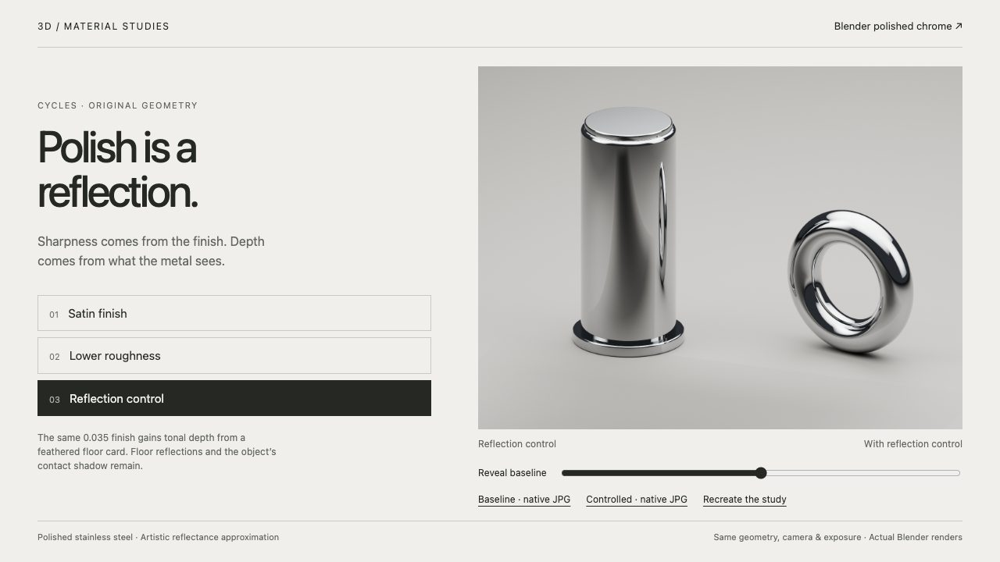

## motion/film (0)

## motion/logo (1)

### logo-mask-motion

Animates a line-drawn logo or illustration by moving its pieces (petals fanning out of a bud, letters rising, bars sliding from behind each other, spokes threading under rings) so they come out from behind one another like cut-out shapes and land on the finished artwork to the pixel, using one mask per piece: no fades, no scaling, no painted-over patches. Covers closed shapes with gaps that open on landing, and open-line marks (rings with spokes, strokes under other strokes) where each line runs on under its neighbours and is revealed, turned or threaded inside its mask. Use it whenever the user wants to animate, bloom, unfold, assemble, reveal, spin or trace an outlined logo or monogram whose pieces overlap or lines meet, when they talk about masking shapes or lines so one slides from behind or under another, or when a logo animation must end on the exact artwork, even without the word "mask". Also for seams, slivers, notches where a line meets a ring, gaps opening too early or line ends in mid-air.

[Open the live demo](https://loouis.github.io/skills/logo-mask-motion/demo/) · [Skill](skills/motion/logo/logo-mask-motion) · [Prompt](skills/motion/logo/logo-mask-motion/demo/PROMPT.md)

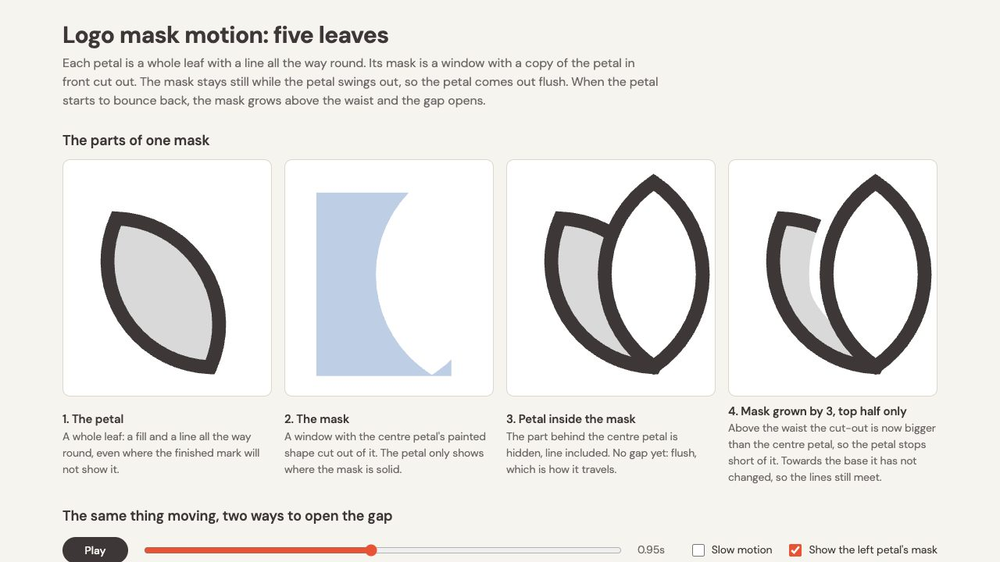

## ui/masking (1)

### vector-masking

Construct accurate masks for overlapping outlined vector logos, icons and illustrations using whole shapes, occluding silhouettes, clean joins and controlled gaps. Use when masking vector pieces, fixing seams or hidden edges, or keeping their occlusion correct as pieces move. Also covers open-line marks such as rings with spokes or strokes that pass under other strokes: each line is extended under its neighbours and revealed, turned or threaded inside a mask cut from the front stroke, so no notch shows where a line meets a ring.

[Open the live demo](https://loouis.github.io/skills/vector-masking/demo/) · [Skill](skills/ui/masking/vector-masking) · [Prompt](skills/ui/masking/vector-masking/demo/PROMPT.md)

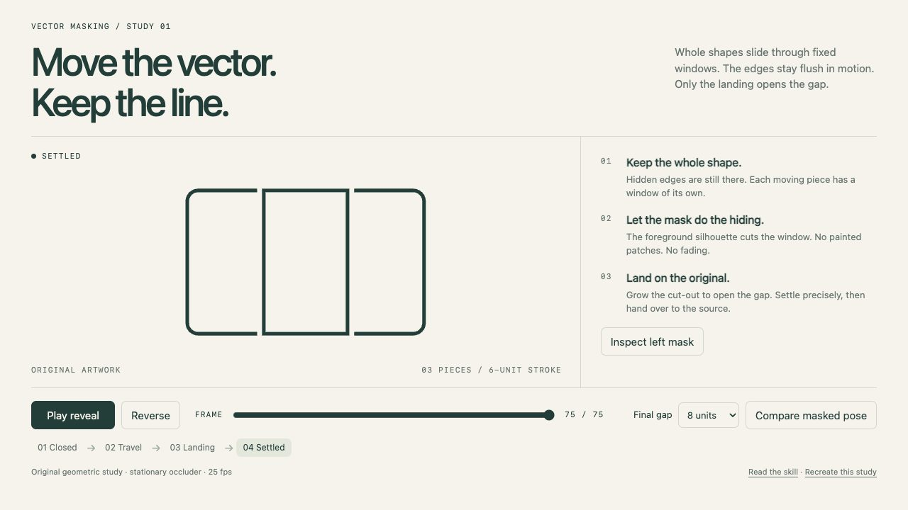

## ui/page-transitions (6)

### gsap-transition-diagonal-tide

Build the Diagonal Tide hand-drawn GSAP page transition. A broad S sweeps across the page on a slant. Use when the user asks for Diagonal Tide, the diagonal-tide transition, or this named draw-swell-cover-reveal effect on a website. Ships reusable curves, adaptive portrait fronts, a covered routing lifecycle and a working demo.

[Open the live demo](https://loouis.github.io/skills/gsap-transition-diagonal-tide/demo/) · [Skill](skills/ui/page-transitions/gsap-transition-diagonal-tide) · [Prompt](skills/ui/page-transitions/gsap-transition-diagonal-tide/demo/PROMPT.md)

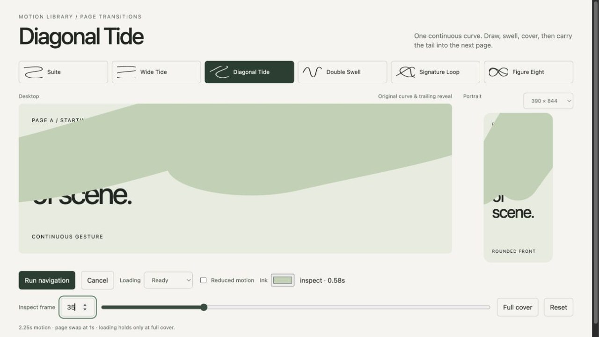

### gsap-transition-double-swell

Build the Double Swell hand-drawn GSAP page transition. Two rounded waves rise and fall across the screen. Use when the user asks for Double Swell, the double-swell transition, or this named draw-swell-cover-reveal effect on a website. Ships reusable curves, adaptive portrait fronts, a covered routing lifecycle and a working demo.

[Open the live demo](https://loouis.github.io/skills/gsap-transition-double-swell/demo/) · [Skill](skills/ui/page-transitions/gsap-transition-double-swell) · [Prompt](skills/ui/page-transitions/gsap-transition-double-swell/demo/PROMPT.md)

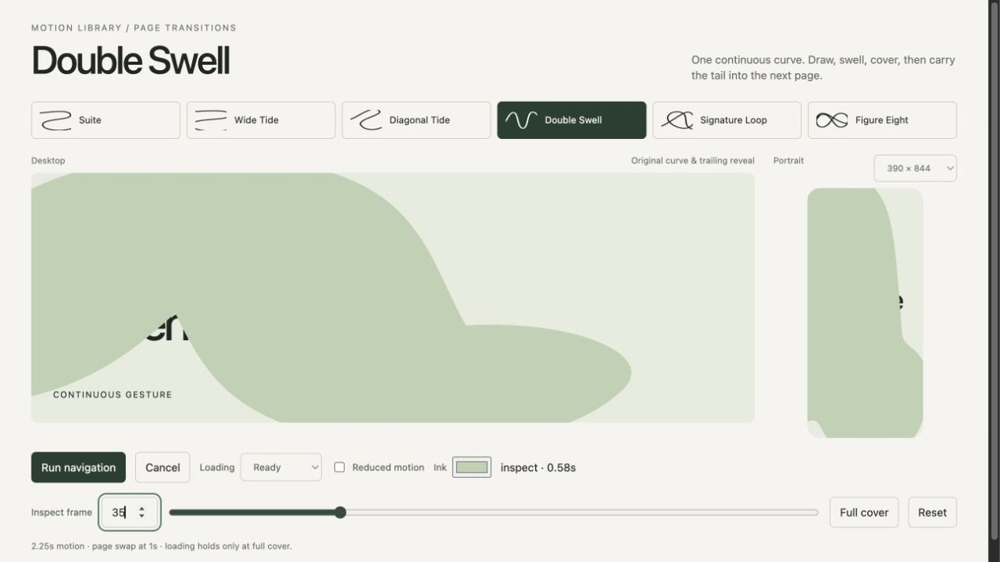

### gsap-transition-figure-eight

Build the Figure Eight hand-drawn GSAP page transition. Two loose loops cross and open across the frame. Use when the user asks for Figure Eight, the figure-eight transition, or this named draw-swell-cover-reveal effect on a website. Ships reusable curves, adaptive portrait fronts, a covered routing lifecycle and a working demo.

[Open the live demo](https://loouis.github.io/skills/gsap-transition-figure-eight/demo/) · [Skill](skills/ui/page-transitions/gsap-transition-figure-eight) · [Prompt](skills/ui/page-transitions/gsap-transition-figure-eight/demo/PROMPT.md)

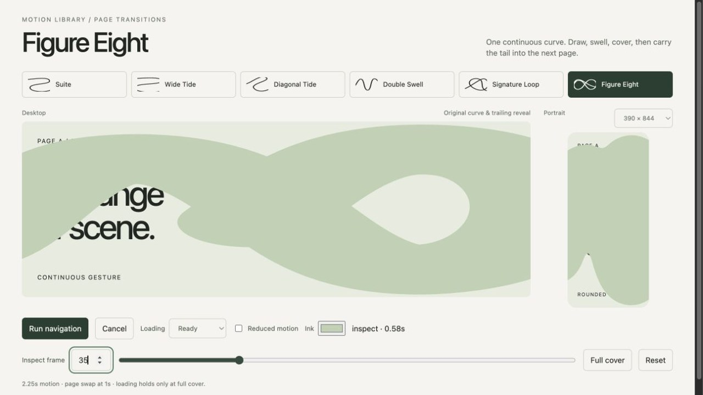

### gsap-transition-signature-loop

Build the Signature Loop hand-drawn GSAP page transition. A tilted loop with a long, handwritten flourish. Use when the user asks for Signature Loop, the signature transition, or this named draw-swell-cover-reveal effect on a website. Ships reusable curves, adaptive portrait fronts, a covered routing lifecycle and a working demo.

[Open the live demo](https://loouis.github.io/skills/gsap-transition-signature-loop/demo/) · [Skill](skills/ui/page-transitions/gsap-transition-signature-loop) · [Prompt](skills/ui/page-transitions/gsap-transition-signature-loop/demo/PROMPT.md)

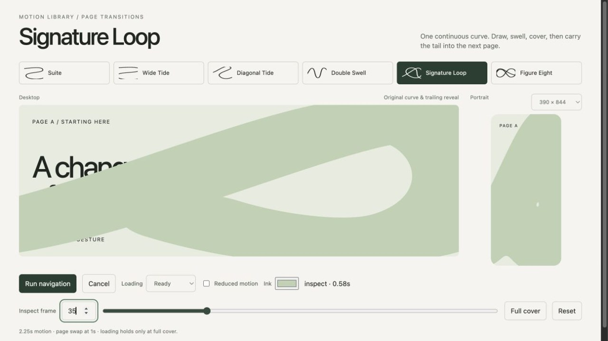

### gsap-transition-suite

Build the Suite hand-drawn GSAP page transition. One broad S-curve rolls from top to bottom. Use when the user asks for Suite, the wave transition, or this named draw-swell-cover-reveal effect on a website. Ships reusable curves, adaptive portrait fronts, a covered routing lifecycle and a working demo.

[Open the live demo](https://loouis.github.io/skills/gsap-transition-suite/demo/) · [Skill](skills/ui/page-transitions/gsap-transition-suite) · [Prompt](skills/ui/page-transitions/gsap-transition-suite/demo/PROMPT.md)

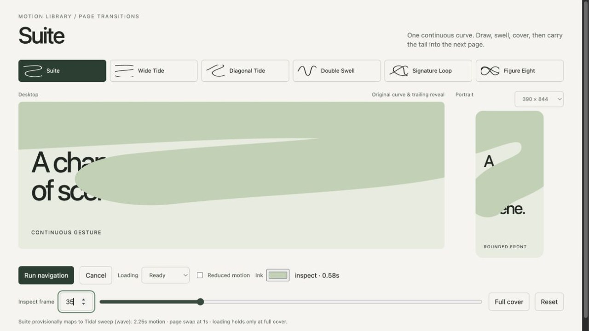

### gsap-transition-wide-tide

Build the Wide Tide hand-drawn GSAP page transition. Long horizontal sweeps with turns beyond the frame. Use when the user asks for Wide Tide, the wide-tide transition, or this named draw-swell-cover-reveal effect on a website. Ships reusable curves, adaptive portrait fronts, a covered routing lifecycle and a working demo.

[Open the live demo](https://loouis.github.io/skills/gsap-transition-wide-tide/demo/) · [Skill](skills/ui/page-transitions/gsap-transition-wide-tide) · [Prompt](skills/ui/page-transitions/gsap-transition-wide-tide/demo/PROMPT.md)

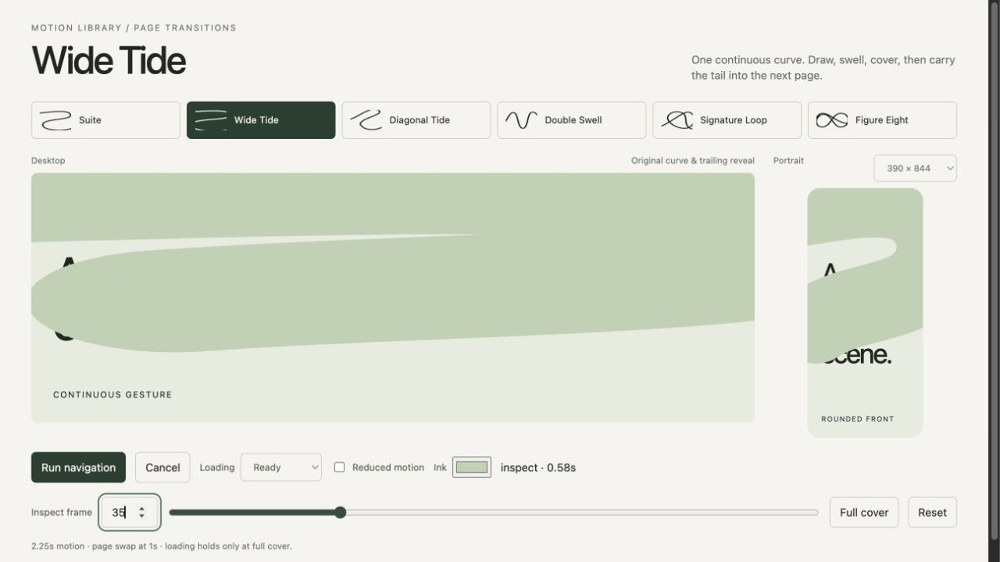

## ui/sections (9)

### gooey-section-drift

Rebuilds the 'Drift' gooey section edge from Louis's motion labs (gooey-sections.html, tab 7): the crest surfs sideways along the edge in the direction you scroll. The boundary between two page sections acts like a liquid surface driven by scroll speed. Use this skill whenever the user asks for the drift goo or drift edge, or wants a section edge whose bulge travels or surfs sideways as you scroll, or for gooey sections tab 7, on a plain HTML page, a Webflow site or a React/Next.js app, even if they only name the feel. It ships a verified 1:1 port of the lab engine, so the result matches the lab exactly.

[Open the live demo](https://loouis.github.io/skills/gooey-section-drift/demo/) · [Skill](skills/ui/sections/gooey-section-drift) · [Prompt](skills/ui/sections/gooey-section-drift/demo/PROMPT.md)

### gooey-section-elastic

Rebuilds the 'Elastic' gooey section edge from Louis's motion labs (gooey-sections.html, tab 5): twangy: it overshoots whatever the scroll asks for and springs back past flat before settling. The boundary between two page sections acts like a liquid surface driven by scroll speed. Use this skill whenever the user asks for the elastic goo or elastic edge, or wants a bouncy, springy, twangy or rubber-band section edge, or for gooey sections tab 5, on a plain HTML page, a Webflow site or a React/Next.js app, even if they only name the feel. It ships a verified 1:1 port of the lab engine, so the result matches the lab exactly.

[Open the live demo](https://loouis.github.io/skills/gooey-section-elastic/demo/) · [Skill](skills/ui/sections/gooey-section-elastic) · [Prompt](skills/ui/sections/gooey-section-elastic/demo/PROMPT.md)

### gooey-section-goo

Rebuilds the 'Goo' gooey section edge from Louis's motion labs (gooey-sections.html, tab 2): a tight, sticky pull whose flanks sink slightly before rejoining the flat line. The boundary between two page sections acts like a liquid surface driven by scroll speed. Use this skill whenever the user asks for the goo edge, 'the goo one' or the sticky goo, or for gooey sections tab 2, on a plain HTML page, a Webflow site or a React/Next.js app, even if they only name the feel. This is the default feel: also use it when someone asks for a gooey, goo, liquid, blobby or melting section edge, divider or transition without naming a variant. It ships a verified 1:1 port of the lab engine, so the result matches the lab exactly.

[Open the live demo](https://loouis.github.io/skills/gooey-section-goo/demo/) · [Skill](skills/ui/sections/gooey-section-goo) · [Prompt](skills/ui/sections/gooey-section-goo/demo/PROMPT.md)

### gooey-section-honey

Rebuilds the 'Honey' gooey section edge from Louis's motion labs (gooey-sections.html, tab 4): a heavy, full blob that is slow to rise and droops back very slowly. The boundary between two page sections acts like a liquid surface driven by scroll speed. Use this skill whenever the user asks for the honey goo or honey edge, or wants a heavy, slow, syrupy or droopy section edge, or for gooey sections tab 4, on a plain HTML page, a Webflow site or a React/Next.js app, even if they only name the feel. It ships a verified 1:1 port of the lab engine, so the result matches the lab exactly.

[Open the live demo](https://loouis.github.io/skills/gooey-section-honey/demo/) · [Skill](skills/ui/sections/gooey-section-honey) · [Prompt](skills/ui/sections/gooey-section-honey/demo/PROMPT.md)

### gooey-section-peel

Rebuilds the 'Peel' gooey section edge from Louis's motion labs (gooey-sections.html, tab 9): it drains fast from full stretch, then the last of it peels off slowly. The boundary between two page sections acts like a liquid surface driven by scroll speed. Use this skill whenever the user asks for the peel goo or peel edge, or wants a section edge that lets go fast then lingers with a slow tail, or for gooey sections tab 9, on a plain HTML page, a Webflow site or a React/Next.js app, even if they only name the feel. It ships a verified 1:1 port of the lab engine, so the result matches the lab exactly.

[Open the live demo](https://loouis.github.io/skills/gooey-section-peel/demo/) · [Skill](skills/ui/sections/gooey-section-peel) · [Prompt](skills/ui/sections/gooey-section-peel/demo/PROMPT.md)

### gooey-section-slosh

Rebuilds the 'Slosh' gooey section edge from Louis's motion labs (gooey-sections.html, tab 8): a liquid lean: the edge rises on one side of the cursor and dips on the other, like water tilting. The boundary between two page sections acts like a liquid surface driven by scroll speed. Use this skill whenever the user asks for the slosh goo or slosh edge, or wants a section edge that tilts, leans or sloshes like liquid, or for gooey sections tab 8, on a plain HTML page, a Webflow site or a React/Next.js app, even if they only name the feel. It ships a verified 1:1 port of the lab engine, so the result matches the lab exactly.

[Open the live demo](https://loouis.github.io/skills/gooey-section-slosh/demo/) · [Skill](skills/ui/sections/gooey-section-slosh) · [Prompt](skills/ui/sections/gooey-section-slosh/demo/PROMPT.md)

### gooey-section-taffy

Rebuilds the 'Taffy' gooey section edge from Louis's motion labs (gooey-sections.html, tab 3): it stretches smoothly while you scroll; let go and it drops, overshoots past flat, comes back and gives one small wobble. The boundary between two page sections acts like a liquid surface driven by scroll speed. Use this skill whenever the user asks for the taffy goo or taffy edge, or wants a scroll-driven section edge that stretches and then snaps back with a single wobble, or for gooey sections tab 3, on a plain HTML page, a Webflow site or a React/Next.js app, even if they only name the feel. It ships a verified 1:1 port of the lab engine, so the result matches the lab exactly.

[Open the live demo](https://loouis.github.io/skills/gooey-section-taffy/demo/) · [Skill](skills/ui/sections/gooey-section-taffy) · [Prompt](skills/ui/sections/gooey-section-taffy/demo/PROMPT.md)

### gooey-section-twin

Rebuilds the 'Twin' gooey section edge from Louis's motion labs (gooey-sections.html, tab 6): the main pull with a smaller sympathetic blob rising beside it. The boundary between two page sections acts like a liquid surface driven by scroll speed. Use this skill whenever the user asks for the twin goo or twin edge, or wants a section edge with two blobs or a double bulge, or for gooey sections tab 6, on a plain HTML page, a Webflow site or a React/Next.js app, even if they only name the feel. It ships a verified 1:1 port of the lab engine, so the result matches the lab exactly.

[Open the live demo](https://loouis.github.io/skills/gooey-section-twin/demo/) · [Skill](skills/ui/sections/gooey-section-twin) · [Prompt](skills/ui/sections/gooey-section-twin/demo/PROMPT.md)

### gooey-section-wave

Rebuilds the 'Wave' gooey section edge from Louis's motion labs (gooey-sections.html, tab 1): a broad, flowing crest with a soft shoulder trailing to its right. The boundary between two page sections acts like a liquid surface driven by scroll speed. Use this skill whenever the user asks for the wave goo, the wave edge, the wave section divider, 'the wave one' or Louis's favourite goo, or for gooey sections tab 1, on a plain HTML page, a Webflow site or a React/Next.js app, even if they only name the feel. It ships a verified 1:1 port of the lab engine, so the result matches the lab exactly.

[Open the live demo](https://loouis.github.io/skills/gooey-section-wave/demo/) · [Skill](skills/ui/sections/gooey-section-wave) · [Prompt](skills/ui/sections/gooey-section-wave/demo/PROMPT.md)

