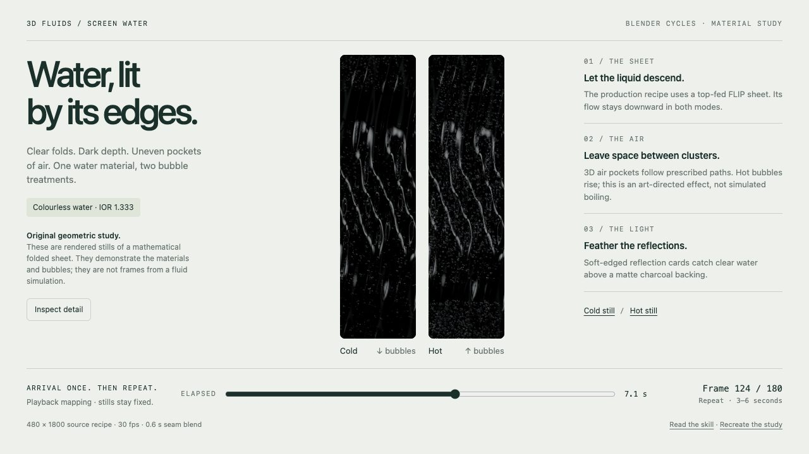

<!-- Generated by scripts/build-gallery.cjs from SKILL.md, agents/openai.yaml and scripts/skill-pages.json. Edit those, then rebuild. -->

# Blender Screen Water: FLIP water sheet and bubbles for tall displays

Clear FLIP water sheets, clustered bubbles and loops. An agent skill for Claude Code, Codex and other AI coding agents.

[Open the live demo](https://loouis.github.io/skills/blender-screen-water/demo/) · [Demo source](demo/index.html) · [Demo prompt](demo/PROMPT.md) · [SKILL.md](SKILL.md) · [References](REFERENCES.md)

## What it does

Build and render a top-fed Blender FLIP water sheet for tall displays, with clear-water optics, dark depth, feathered reflections and clustered 3D bubbles. Use for cold or hot screen-water effects, native rerenders, partial-loop encoding and drain-and-fade playback. Product geometry and camera choreography are separate.

## Use it

- **Claude Code**: copy this folder to `~/.claude/skills/blender-screen-water/` (or run `python3 install.py` from the repository root), then ask in your own words or call `/blender-screen-water`.
- **Codex**: copy this folder into your Codex skills directory and ask: "Use $blender-screen-water to create a clear descending water sheet with clustered bubbles, dark depth and a forward partial repeat."
- **Other agents**: point the agent at [SKILL.md](SKILL.md) and let it follow the steps.

**Tags:** Blender · Cycles · FLIP fluid simulation · water sheet · bubbles · tall screen displays · seamless loop

## More 3D Fluids skills

- [Water Optics · Clear Studio](../water-optics-clear-studio) - Clear water, curved contact and controlled reflections
- [Water Pool · Sunlight](../water-pool-sunlight) - Floor sunlight and sun rays for pool water, from one light map
- [Water · Product Splash](../water-product-splash) - Folded water sheets, torn rims and product splashes

Part of [loouis/skills](../../../../README.md): agent skills for web designers and 3D builders. Browse them all with live demos at [loouis.github.io/skills](https://loouis.github.io/skills/).
