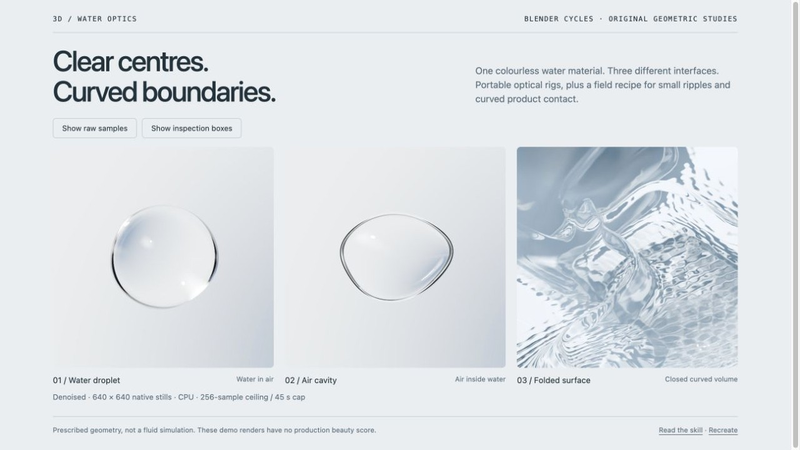

<!-- Generated by scripts/build-gallery.cjs from SKILL.md, agents/openai.yaml and scripts/skill-pages.json. Edit those, then rebuild. -->

# Water Optics · Clear Studio: clear water and droplets on products in Blender

Clear water, curved contact and controlled reflections. An agent skill for Claude Code, Codex and other AI coding agents.

[Open the demo](demo/index.html) · [Demo prompt](demo/PROMPT.md) · [SKILL.md](SKILL.md) · [References](REFERENCES.md)

## What it does

Reproduce and refine clear studio water in Blender with droplet, immersed air-cavity, folded-surface and curved product-contact recipes. Use for transparent contours, reflected lettering, calm pools and local ripples; evaluate motion and fluid dynamics separately.

## Use it

- **Claude Code**: copy this folder to `~/.claude/skills/water-optics-clear-studio/` (or run `python3 install.py` from the repository root), then ask in your own words or call `/water-optics-clear-studio`.
- **Codex**: copy this folder into your Codex skills directory and ask: "Use $water-optics-clear-studio to refine this Blender water scene against my reference, preserving the product and scoring native contact, reflection and open-water details separately."
- **Other agents**: point the agent at [SKILL.md](SKILL.md) and let it follow the steps.

**Tags:** Blender · Cycles · clear water · water droplets · refraction · ripples · product rendering

## More 3D Fluids skills

- [Blender Screen Water](../blender-screen-water) - Clear FLIP water sheets, clustered bubbles and loops
- [Water Pool · Sunlight](../water-pool-sunlight) - Floor sunlight and sun rays for pool water, from one light map
- [Water · Product Splash](../water-product-splash) - Folded water sheets, torn rims and product splashes

Part of [loouis/skills](../../../../README.md): agent skills for web designers and 3D builders.
