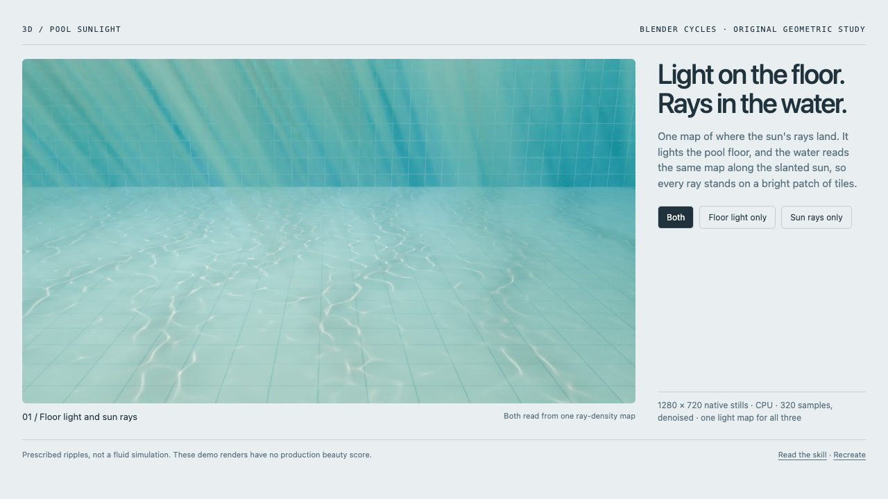

<!-- Generated by scripts/build-gallery.cjs from SKILL.md, agents/openai.yaml and scripts/skill-pages.json. Edit those, then rebuild. -->

# Water Pool · Sunlight: pool caustics and underwater sun rays in Blender

Floor sunlight and sun rays for pool water, from one light map. An agent skill for Claude Code, Codex and other AI coding agents.

[Open the live demo](https://loouis.github.io/skills/water-pool-sunlight/demo/) · [Demo source](demo/index.html) · [Demo prompt](demo/PROMPT.md) · [SKILL.md](SKILL.md) · [References](REFERENCES.md)

## What it does

Make sunlit swimming-pool water in Blender Cycles with the net of sunlight on the pool floor (caustics) and the sun rays coming down through the water, both read from one ray-density map so every shaft stands on a bright patch of floor. Use for any underwater or pool scene that needs floor caustics, light shafts, god rays or dappled water light, as a still or a seamless loop, and whenever a caustic texture reads as a tiled pattern, cracks, marble or wire; evaluate the water surface seen from below and fluid simulation separately.

## Use it

- **Claude Code**: copy this folder to `~/.claude/skills/water-pool-sunlight/` (or run `python3 install.py` from the repository root), then ask in your own words or call `/water-pool-sunlight`.
- **Codex**: copy this folder into your Codex skills directory and ask: "Use $water-pool-sunlight to give this Blender pool scene sunlight on the floor and sun rays through the water, matched to my reference, with the light placed where the picture needs it."
- **Other agents**: point the agent at [SKILL.md](SKILL.md) and let it follow the steps.

**Tags:** Blender · Cycles · caustics · god rays · light shafts · underwater · swimming pool · seamless loop

## More 3D Fluids skills

- [Blender Screen Water](../blender-screen-water) - Clear FLIP water sheets, clustered bubbles and loops
- [Water Optics · Clear Studio](../water-optics-clear-studio) - Clear water, curved contact and controlled reflections
- [Water · Product Splash](../water-product-splash) - Folded water sheets, torn rims and product splashes

Part of [loouis/skills](../../../../README.md): agent skills for web designers and 3D builders. Browse them all with live demos at [loouis.github.io/skills](https://loouis.github.io/skills/).
