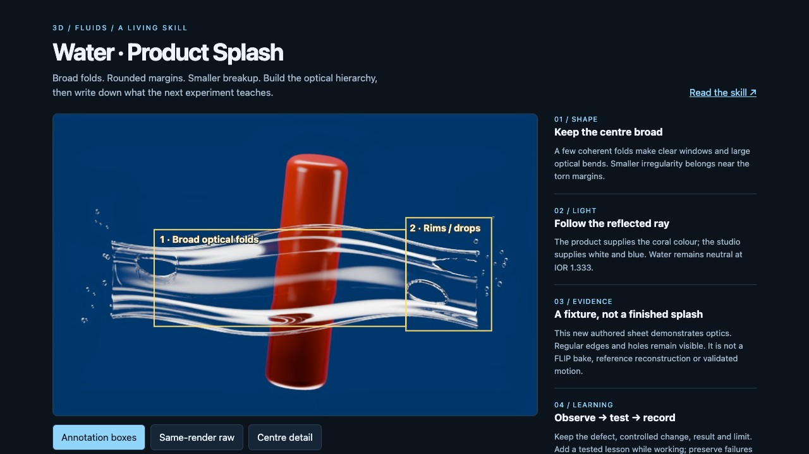

<!-- Generated by scripts/build-gallery.cjs from SKILL.md, agents/openai.yaml and scripts/skill-pages.json. Edit those, then rebuild. -->

# Water · Product Splash: product water splash renders in Blender

Folded water sheets, torn rims and product splashes. An agent skill for Claude Code, Codex and other AI coding agents.

[Open the demo](demo/index.html) · [Demo prompt](demo/PROMPT.md) · [SKILL.md](SKILL.md) · [References](REFERENCES.md)

## What it does

Reconstruct and refine suspended product-water splashes in Blender, including folded sheets, torn rims, jets, ligaments, droplets and optical distortion. Use for water wrapping around or breaking away from a product, reference-led splash studies, and adapting a reviewed splash to another product. Still reconstruction is tested; validate new collisions and motion separately.

## Use it

- **Claude Code**: copy this folder to `~/.claude/skills/water-product-splash/` (or run `python3 install.py` from the repository root), then ask in your own words or call `/water-product-splash`.
- **Codex**: copy this folder into your Codex skills directory and ask: "Use $water-product-splash to reconstruct a suspended product splash, review each pass, and save newly demonstrated lessons."
- **Other agents**: point the agent at [SKILL.md](SKILL.md) and let it follow the steps.

**Tags:** Blender · Cycles · water splash · liquid simulation · droplets · product CGI · product rendering

## More 3D Fluids skills

- [Blender Screen Water](../blender-screen-water) - Clear FLIP water sheets, clustered bubbles and loops
- [Water Optics · Clear Studio](../water-optics-clear-studio) - Clear water, curved contact and controlled reflections
- [Water Pool · Sunlight](../water-pool-sunlight) - Floor sunlight and sun rays for pool water, from one light map

Part of [loouis/skills](../../../../README.md): agent skills for web designers and 3D builders.
