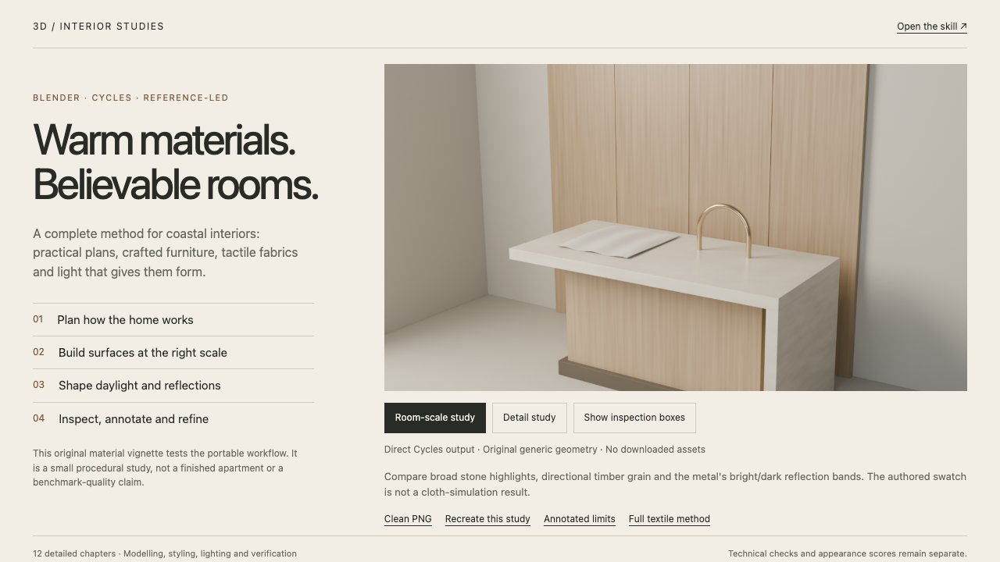

<!-- Generated by scripts/build-gallery.cjs from SKILL.md, agents/openai.yaml and scripts/skill-pages.json. Edit those, then rebuild. -->

# Coastal Interior Render: photoreal Blender interiors in natural daylight

Warm coastal interiors with rigorous realism review. An agent skill for Claude Code, Codex and other AI coding agents.

[Open the demo](demo/index.html) · [Demo prompt](demo/PROMPT.md) · [SKILL.md](SKILL.md) · [References](REFERENCES.md)

## What it does

Build and refine editable Blender/Cycles coastal apartment interiors with warm timber, restrained stone, natural daylight and tactile furniture. Use for premium beachfront kitchen/living scenes, Burly- or MIRA-inspired art direction, practical layout, kitchen construction, upholstery, throws/fringe, glazing, balconies, reference comparison and annotated realism reviews. Includes detailed modelling, material, lighting and failure-recovery methods. Do not use as a promise of an automatic quality score, a construction specification or a substitute for a requested direct 3D render.

## Use it

- **Claude Code**: copy this folder to `~/.claude/skills/coastal-interior-render/` (or run `python3 install.py` from the repository root), then ask in your own words or call `/coastal-interior-render`.
- **Codex**: copy this folder into your Codex skills directory and ask: "Use $coastal-interior-render to build an editable premium coastal kitchen and living room with warm timber, quiet stone, natural daylight and a fully reviewed render."
- **Other agents**: point the agent at [SKILL.md](SKILL.md) and let it follow the steps.

**Tags:** Blender · Cycles · interior rendering · architectural visualization · archviz · photorealism · daylight

Part of [loouis/skills](../../../../README.md): agent skills for web designers and 3D builders.
