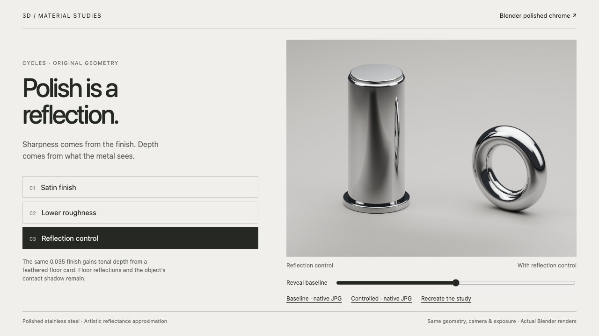

<!-- Generated by scripts/build-gallery.cjs from SKILL.md, agents/openai.yaml and scripts/skill-pages.json. Edit those, then rebuild. -->

# Blender Polished Chrome: realistic chrome and mirror-polished metal

Mirror-polished metal materials and studio reflections. An agent skill for Claude Code, Codex and other AI coding agents.

[Open the demo](demo/index.html) · [Demo prompt](demo/PROMPT.md) · [SKILL.md](SKILL.md) · [References](REFERENCES.md)

## What it does

Create realistic chrome and mirror-polished metal renders in Blender Cycles. Use for polished stainless steel, chrome plating, satin-looking metal, harsh reflection bands, and studio material or lighting refinement while preserving product geometry.

## Use it

- **Claude Code**: copy this folder to `~/.claude/skills/blender-polished-chrome/` (or run `python3 install.py` from the repository root), then ask in your own words or call `/blender-polished-chrome`.
- **Codex**: copy this folder into your Codex skills directory and ask: "Use $blender-polished-chrome to refine this Blender scene into convincing mirror-polished metal while preserving its material identity and geometry."
- **Other agents**: point the agent at [SKILL.md](SKILL.md) and let it follow the steps.

**Tags:** Blender · Cycles · chrome material · polished metal · stainless steel · reflections · product rendering

Part of [loouis/skills](../../../../README.md): agent skills for web designers and 3D builders.
