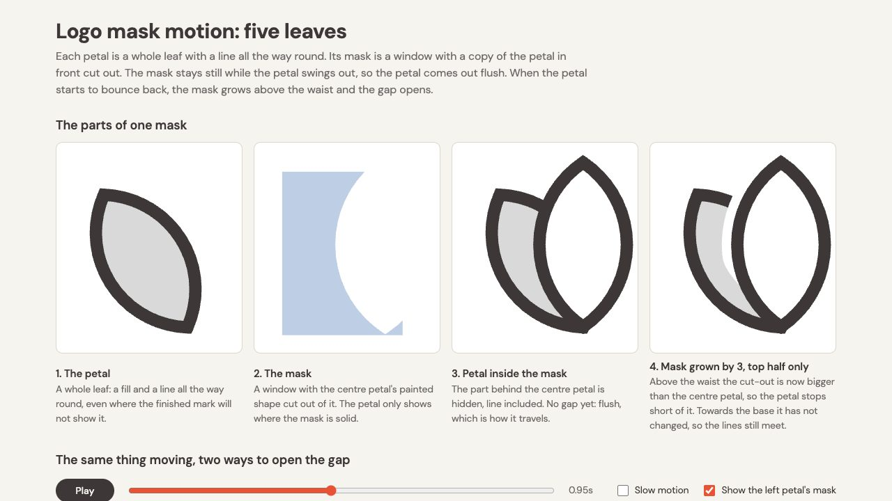

<!-- Generated by scripts/build-gallery.cjs from SKILL.md, agents/openai.yaml and scripts/skill-pages.json. Edit those, then rebuild. -->

# Logo Mask Motion: animate a line logo with masks and land on the artwork

Move the pieces of a line-drawn mark with masks and land on the artwork. An agent skill for Claude Code, Codex and other AI coding agents.

[Open the demo](demo/index.html) · [Demo prompt](demo/PROMPT.md) · [SKILL.md](SKILL.md) · [References](REFERENCES.md)

## What it does

Animates a line-drawn logo or illustration by moving its pieces (petals fanning out of a bud, letters rising, bars sliding from behind each other, spokes threading under rings) so they come out from behind one another like cut-out shapes and land on the finished artwork to the pixel, using one mask per piece: no fades, no scaling, no painted-over patches. Covers closed shapes with gaps that open on landing, and open-line marks (rings with spokes, strokes under other strokes) where each line runs on under its neighbours and is revealed, turned or threaded inside its mask. Use it whenever the user wants to animate, bloom, unfold, assemble, reveal, spin or trace an outlined logo or monogram whose pieces overlap or lines meet, when they talk about masking shapes or lines so one slides from behind or under another, or when a logo animation must end on the exact artwork, even without the word "mask". Also for seams, slivers, notches where a line meets a ring, gaps opening too early or line ends in mid-air.

## Use it

- **Claude Code**: copy this folder to `~/.claude/skills/logo-mask-motion/` (or run `python3 install.py` from the repository root), then ask in your own words or call `/logo-mask-motion`.
- **Codex**: copy this folder into your Codex skills directory and ask: "Use $logo-mask-motion to animate the pieces of this outlined logo moving apart and landing back on the artwork exactly, using one mask per piece."
- **Other agents**: point the agent at [SKILL.md](SKILL.md) and let it follow the steps.

**Tags:** logo animation · SVG animation · masking · motion design · monogram · Lottie · After Effects

Part of [loouis/skills](../../../../README.md): agent skills for web designers and 3D builders.
