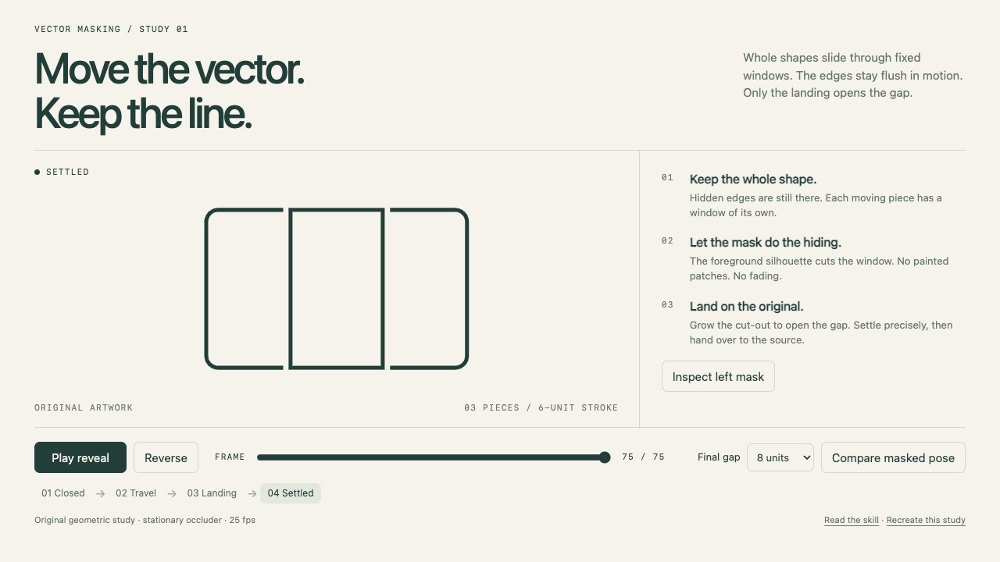

<!-- Generated by scripts/build-gallery.cjs from SKILL.md, agents/openai.yaml and scripts/skill-pages.json. Edit those, then rebuild. -->

# Vector Masking: clean masks for overlapping vector logos and illustrations

Accurate vector masks, clean joins and controlled gaps. An agent skill for Claude Code, Codex and other AI coding agents.

[Open the demo](demo/index.html) · [Demo prompt](demo/PROMPT.md) · [SKILL.md](SKILL.md) · [References](REFERENCES.md)

## What it does

Construct accurate masks for overlapping outlined vector logos, icons and illustrations using whole shapes, occluding silhouettes, clean joins and controlled gaps. Use when masking vector pieces, fixing seams or hidden edges, or keeping their occlusion correct as pieces move. Also covers open-line marks such as rings with spokes or strokes that pass under other strokes: each line is extended under its neighbours and revealed, turned or threaded inside a mask cut from the front stroke, so no notch shows where a line meets a ring.

## Use it

- **Claude Code**: copy this folder to `~/.claude/skills/vector-masking/` (or run `python3 install.py` from the repository root), then ask in your own words or call `/vector-masking`.
- **Codex**: copy this folder into your Codex skills directory and ask: "Use $vector-masking to build accurate masks for these vector pieces, preserving whole shapes, clean joins and the original artwork."
- **Other agents**: point the agent at [SKILL.md](SKILL.md) and let it follow the steps.

**Tags:** SVG · vector masks · logo design · illustration · Figma · motion design

Part of [loouis/skills](../../../../README.md): agent skills for web designers and 3D builders.
