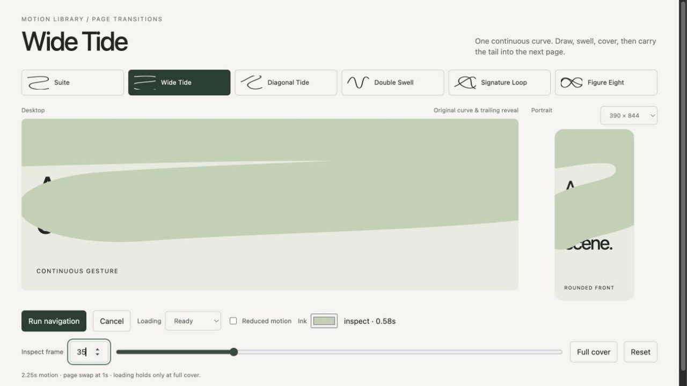

<!-- Generated by scripts/build-gallery.cjs from SKILL.md, agents/openai.yaml and scripts/skill-pages.json. Edit those, then rebuild. -->

# Wide Tide: hand-drawn GSAP page transition for websites

Wide Tide draw, swell and reveal transition. An agent skill for Claude Code, Codex and other AI coding agents.

[Open the demo](demo/index.html) · [Demo prompt](demo/PROMPT.md) · [SKILL.md](SKILL.md) · [References](REFERENCES.md)

## What it does

Build the Wide Tide hand-drawn GSAP page transition. Long horizontal sweeps with turns beyond the frame. Use when the user asks for Wide Tide, the wide-tide transition, or this named draw-swell-cover-reveal effect on a website. Ships reusable curves, adaptive portrait fronts, a covered routing lifecycle and a working demo.

## Use it

- **Claude Code**: copy this folder to `~/.claude/skills/gsap-transition-wide-tide/` (or run `python3 install.py` from the repository root), then ask in your own words or call `/gsap-transition-wide-tide`.
- **Codex**: copy this folder into your Codex skills directory and ask: "Use $gsap-transition-wide-tide to add the Wide Tide page transition to this site."
- **Other agents**: point the agent at [SKILL.md](SKILL.md) and let it follow the steps.

**Tags:** GSAP · page transitions · route transitions · SVG · web animation · Astro · Barba.js

## More Page Transition Skills skills

- [Diagonal Tide Page Transition](../gsap-transition-diagonal-tide) - Diagonal Tide draw, swell and reveal transition
- [Double Swell Page Transition](../gsap-transition-double-swell) - Double Swell draw, swell and reveal transition
- [Figure Eight Page Transition](../gsap-transition-figure-eight) - Figure Eight draw, swell and reveal transition
- [Signature Loop Page Transition](../gsap-transition-signature-loop) - Signature Loop draw, swell and reveal transition
- [Suite Page Transition](../gsap-transition-suite) - Suite draw, swell and reveal transition

Part of [loouis/skills](../../../../README.md): agent skills for web designers and 3D builders.
